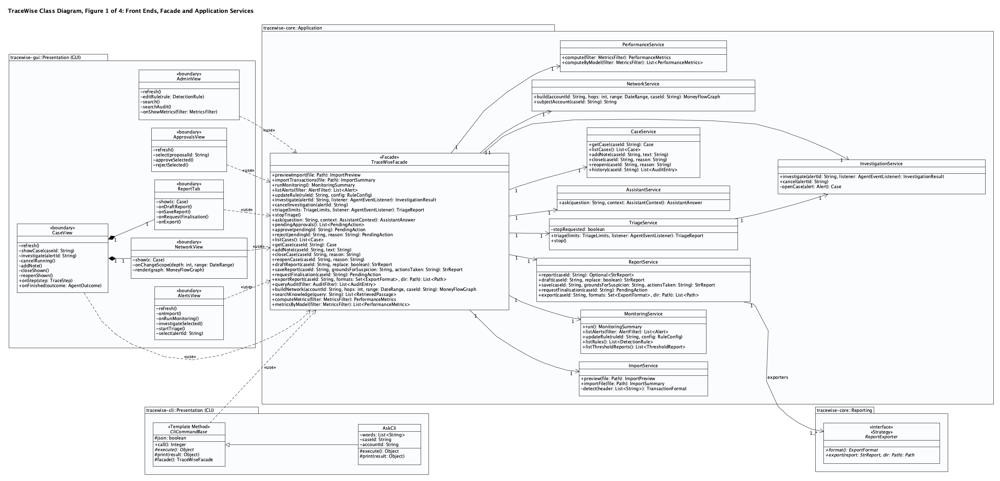
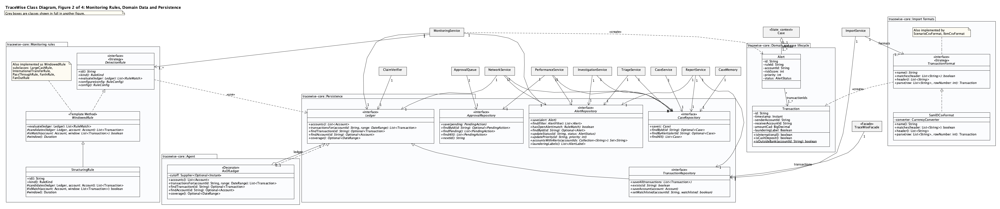
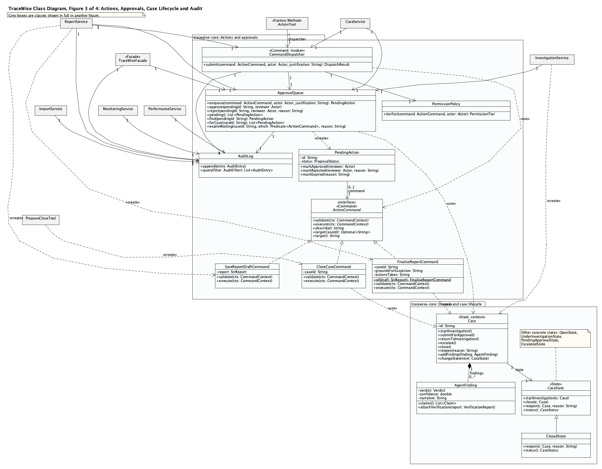
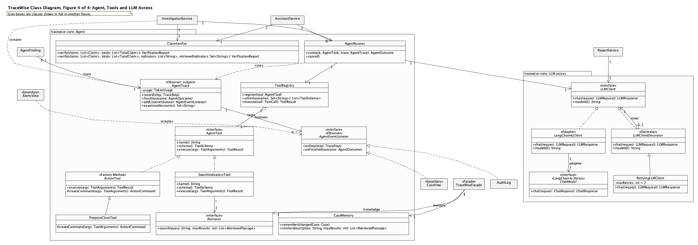
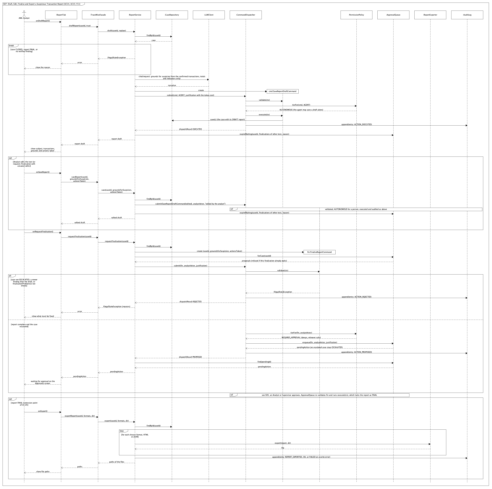
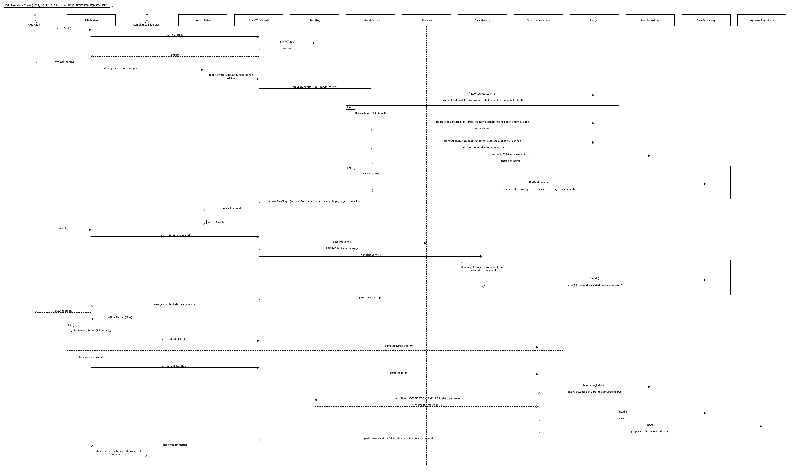
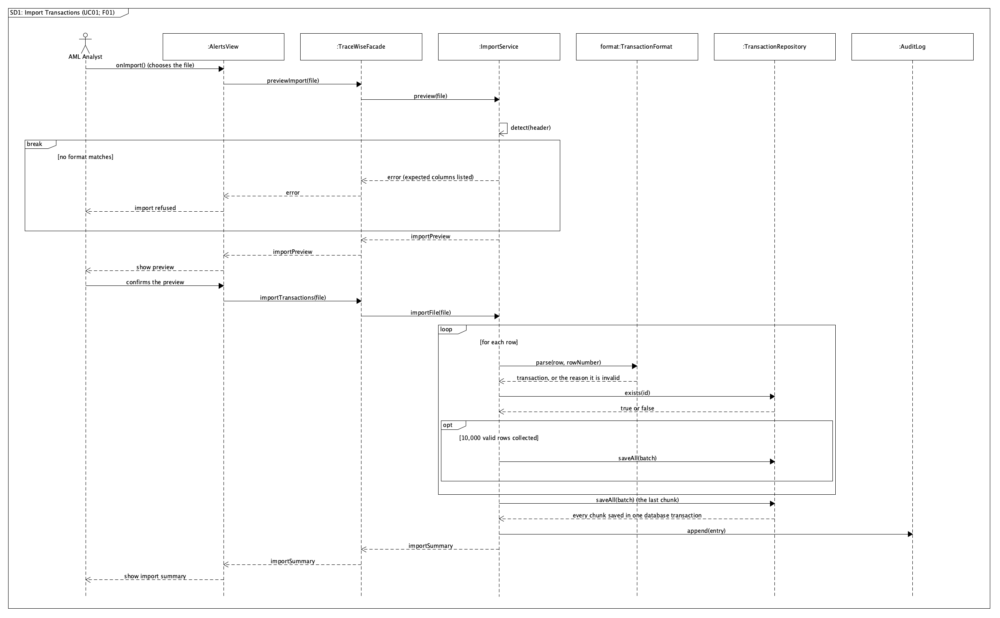
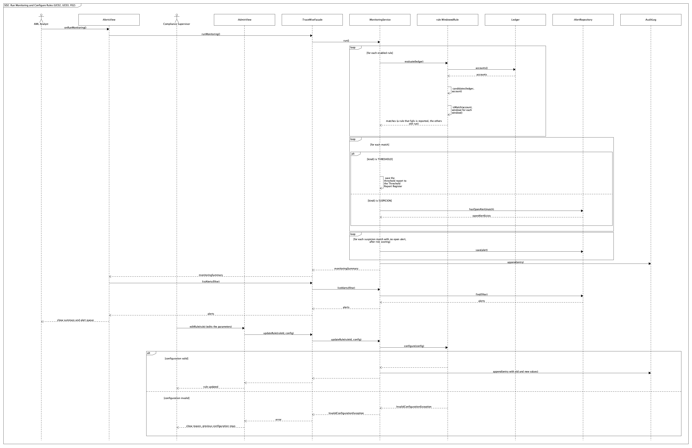
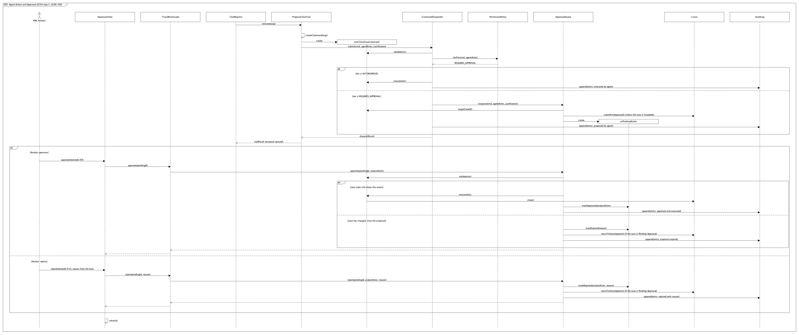

# TraceWise: Stage 2 Implementation Report

| | |
|---|---|
| **Course** | EECS3311 Software Design, Fall 2026, York University |
| **Author** | Kian Khooban |
| **Repository** | https://github.com/kiankhooban/TraceWise |
| **Status of this file** | 2026-11-05. The video links (marked TODO) are added before submission on Nov 10. |

This report follows the Stage 2 instructions: 1 overview and status, 2 feature-to-implementation mapping, 3
implemented patterns and the updated class diagram, 4 changes and rationale, 5 AI tools and collaboration, 6
development and verification summary, 7 demonstration index.

---

# 1. Overview and status

TraceWise is a Java 21 application for anti-money-laundering (AML) teams at a Canadian bank. Deterministic
rules based on FINTRAC guidance raise alerts and keep the Threshold Report Register. An LLM agent (Anthropic
Claude through LangChain4j) then investigates each alert with read tools, retrieval of FINTRAC indicators and
memory of past cases, and writes a finding. A claim verifier checks every figure the finding cites against the
data before anyone sees it. The agent's actions are permission-tiered: low-risk actions run, while closing or
escalating a case waits for a human decision. It has a JavaFX GUI and a picocli CLI over one facade; the CLI runs
one command per call (with `--json` for scripts) or, as `tracewise` alone, an interactive shell where a command
runs as typed and plain words go to the assistant.

**Status.** All 12 Stage 1 features are implemented and run in both the GUI and the CLI. All 9 design patterns
of the Stage 1 report are in the code. The three Maven modules of the Stage 1 architecture are in place:
`tracewise-core` holds all logic and depends on no user interface, and `tracewise-cli` and `tracewise-gui` call
it only through `TraceWiseFacade`. 459 automated tests pass (section 6).

**Measured results** (F12, on SAML-D samples; each alert investigated on a fresh copy of the data, with the data
cut at the alert so the agent has no hindsight):

| Held-out set: 30 laundering, 30 false-alarm alerts | Claude Haiku 5.5 | Claude Sonnet 5.5 (default) |
|---|---|---|
| Laundering alerts caught (escalated) | 28 of 30 | 27 of 30 |
| False alarms cleared (dismissed) | 7 of 30 | 19 of 30 |
| Failed runs | 0 of 75 | 0 of 75 |
| Cost per alert | about CAD 0.02 | about CAD 0.26 |

Before the investigation instructions were reworked, the agent escalated 75 of 75 alerts. Precision on a
balanced 30/30 set is not a real-world figure: at SAML-D's base rate (about 3% of alerts are laundering) it would
be about 0.05 with Haiku, against 0.03 for the rules alone. Details: design changes 41 to 45 and 49, and the
collaboration log entries 15 and 16.

**Not done or limited:** see the remaining limitations in section 6.

# 2. Feature-to-implementation mapping

All 12 features are Stage 1 features (no new, replaced or removed feature) and run from both the GUI and the CLI.
Paths are under `core/src/main/java/tracewise/` unless they start with `cli/` or `gui/` (short for
`cli/src/main/java/tracewise/ui/cli/` and `gui/src/main/java/tracewise/ui/gui/`). Every front-end action goes
through `TraceWiseFacade` (Facade) to one application service, so that step is not repeated below. Every CLI
command extends `cli/CliCommandBase` (Template Method: run, print as text or JSON, map errors to exit codes); its
text layout uses the CLI-only `cli/Style` (labels, tables, wrapped prose, colour on a terminal only), and
`cli/TraceWiseShell` is the interactive shell that runs the same commands (design change 51).

| Feature | Stage 1 | Status | Type | Design patterns | Video |
|---|---|---|---|---|---|
| F01 Transaction Data Import | F01 | Implemented | Deterministic | Strategy, Facade, Template Method (CLI) | TODO |
| F02 Rule-Based Monitoring, Threshold Reporting, Alert Queue | F02 | Implemented | Deterministic | Strategy, Template Method, Facade | TODO |
| F03 Autonomous Alert Investigation | F03 | Modified (section 4: no hindsight, decision method) | AI-based | Observer, Adapter, Decorator, State, Strategy, Facade | TODO |
| F04 Indicator Retrieval and Case Memory | F04 | Implemented | Hybrid | Strategy, Facade | TODO |
| F05 Claim Verification | F05 | Implemented | Deterministic | none (a deterministic check used by F03, F10, F11) | TODO |
| F06 Agent Actions and Approval Queue | F06 | Implemented | Hybrid | Command, Factory Method, State | TODO |
| F07 Autonomous Queue Triage | F07 | Implemented | AI-based | Observer, Facade | TODO |
| F08 Case Management and Audit Trail | F08 | Implemented | Deterministic | State, Command, Observer | TODO |
| F09 Money-Flow Network View | F09 | Implemented | Deterministic | Facade | TODO |
| F10 Natural-Language Analyst Assistant | F10 | Implemented | AI-based | Template Method, Strategy, Facade | TODO |
| F11 STR Drafting and Export | F11 | Modified (section 4: finalisation command) | Hybrid | Command, Strategy, Facade | TODO |
| F12 Agent Performance Dashboard | F12 | Modified (section 4: false-alarm definition) | Deterministic | Facade | TODO |

### F01 Transaction Data Import

- **Classes:** `app/ImportService` (reads the file, validates rows, saves), `ingest/TransactionFormat` with
  `ScenarioCsvFormat`, `IbmCsvFormat` and `SamlDCsvFormat` (one per file layout), `ingest/CurrencyConverter` (Bank
  of Canada rates to CAD), `persistence/TransactionRepository`; `gui/AlertsView`, `cli/ImportCli`.
- **Key methods:** `previewImport()`, `importTransactions()`, `ImportService.preview()`, `importFile()`,
  `detect(header)`, `TransactionFormat.parse(row, rowNumber)`, `TransactionRepository.saveAll()`.
- **From input to result:** the analyst picks a CSV (Import CSV, or `tracewise import <file>`); `ImportService`
  picks the format whose header matches, parses each row into a `Transaction` in CAD, lists rejected rows with their
  row numbers, saves valid rows in chunks of 10,000 inside one database transaction and audits the import.

### F02 Rule-Based Monitoring, Threshold Reporting, Alert Queue

- **Classes:** `app/MonitoringService` (runs the rules, records results), `monitoring/DetectionRule` and the six
  rules on `WindowedRule`, `monitoring/RiskScorer`, `persistence/AlertRepository`; `gui/AlertsView` and the Admin
  Rules tab, `cli/MonitorCli`, `cli/AlertsCli`, `cli/ThresholdReportsCli`, `cli/RulesCli`.
- **Key methods:** `runMonitoring()`, `MonitoringService.run()`, `WindowedRule.evaluate()` (final) with each rule's
  `candidates()` and `isMatch(account, window)`, `hasOpenAlert()`, `listAlerts()`, `updateRule()`.
- **From input to result:** Run monitoring (or `tracewise monitor run`) evaluates every enabled rule over the
  ledger; threshold rules R1 and R2 write the Threshold Report Register, suspicion rules R3 to R6 become alerts
  with a risk score, one per pattern; a supervisor changes a rule's parameters, which are validated and audited.

### F03 Autonomous Alert Investigation

- **Classes:** `app/InvestigationService` (opens the case and runs the agent), `agent/AgentRunner` (the
  tool-calling loop with turn and cost limits), `agent/InvestigationTask` (instructions and answer format),
  `agent/AgentTrace` (steps, tokens, cost; observed by the GUI and the audit log), `llm/LLMClient` with
  `LangChain4jClient` and the retry and recording decorators, `agent/tools/` (read tools over `AsOfLedger`),
  `domain/Case`; `gui/CaseView`, `cli/InvestigateCli`.
- **Key methods:** `investigate(alertId, listener)`, `AgentRunner.run(task, trace)`, `LLMClient.chat()`,
  `ToolRegistry.execute()`, `AgentTrace.record()`, `onStep()`, `finish()`, `Case.addFinding()`.
- **From input to result:** F2 on an alert (or `tracewise investigate <alert>`) opens its case; the agent reads
  the account's history, aggregates, counterparties and linked alerts as they stood at the alert, retrieves FINTRAC
  indicators and similar cases (F04), may act (F06), and ends with a verdict, confidence and narrative that F05
  verifies before it is shown. Each step appears live in the Agent steps tab.

### F04 Indicator Retrieval and Case Memory

- **Classes:** `retrieval/Retriever` and `EmbeddingRetriever` (a local bge-small embedding model over
  `IndicatorCorpus`, FINTRAC's 110 indicators), `retrieval/CaseMemory` (decided cases),
  `agent/tools/SearchIndicatorsTool` and `SimilarCasesTool`; the Evidence tab and Admin Knowledge tab,
  `cli/IndicatorsCli`, `cli/CasesCli`.
- **Key methods:** `Retriever.search(query, maxResults)`, `CaseMemory.similar()`, `remember()`, `searchKnowledge()`.
- **From input to result:** during an investigation the agent calls the two tools; in Admin, a plain-language
  query returns the five best indicators and five past cases with their scores. The model writes the query; the
  ranking is deterministic.

### F05 Claim Verification

- **Classes:** `verification/ClaimVerifier`, `VerificationReport`, `ClaimCheck`; shown in the Finding tab, the
  Approvals screen and the Assistant panel, and in `--json` output.
- **Key methods:** `ClaimVerifier.verify(claims, totals, indicators, retrievedIndicators)`,
  `AgentFinding.attachVerification()`.
- **From input to result:** every transaction the agent cites is looked up in the ledger and compared by id, amount
  and date; every total is recomputed; every indicator must be one the agent retrieved. Each check is shown as VER or
  REJ, and a finding with a rejected claim is marked unverified.

### F06 Agent Actions and Approval Queue

- **Classes:** `agent/tools/ActionTool` and its six subclasses (each creates its command), `actions/ActionCommand`
  and the commands, `CommandDispatcher` (one entry for every change), `PermissionPolicy`, `ApprovalQueue`,
  `PendingAction`; `gui/ApprovalsView`, `cli/ApprovalsCli`.
- **Key methods:** `ActionTool.createCommand()`, `CommandDispatcher.submit()`, `PermissionPolicy.tierFor()`,
  `ApprovalQueue.enqueue()`, `approve()`, `reject()`, `ActionCommand.validate()` and `execute()`.
- **From input to result:** the agent may set priority, link alerts, watchlist an account and create tasks on its
  own case; closing or escalating becomes a proposal. On Approvals, F9 approves (the command is re-validated and run,
  or expires if the case changed) and F10 rejects with a reason the agent sees next time. Every step is audited.

### F07 Autonomous Queue Triage

- **Classes:** `app/TriageService`, `app/TriageLimits`, `agent/TriageReport`; `gui/AlertsView`, `cli/TriageCli`.
- **Key methods:** `triage(limits, listener)`, `TriageService.triage()`, `stop()`, `InvestigationService.investigate()`.
- **From input to result:** F3 (or `tracewise triage --max-alerts --max-cost`) investigates the open alerts in risk
  order, re-checking each just before, until the queue is done, a limit is reached, Stop is pressed or three runs
  fail in a row; the agent's steps stream into the activity log and a summary lists each alert's outcome.

### F08 Case Management and Audit Trail

- **Classes:** `domain/Case` with the states in `cases/state/`, `app/CaseService`, the note, close and reopen
  commands, `audit/AuditLog`; `gui/CaseView` (Notes, Tasks, History) and the Admin Audit log tab, `cli/CaseCli`,
  `cli/AuditCli`.
- **Key methods:** `getCase()`, `addNote()`, `closeCase()`, `reopenCase()`, `Case.reopen()`, `CaseState.reopen()`,
  `queryAudit(filter)`, `AuditLog.append()`.
- **From input to result:** notes, closing and reopening go through the dispatcher like the agent's actions; the
  case's state object allows or refuses the transition; the audit log records every action with its actor (AGENT,
  HUMAN or SYSTEM) and can be filtered and exported to CSV.

### F09 Money-Flow Network View

- **Classes:** `app/NetworkService`, `network/MoneyFlowGraph`; `gui/NetworkView` (SmartGraph), `cli/NetworkCli`.
- **Key methods:** `buildNetwork(accountId, hops, range, caseId)`, `NetworkService.build()`, `NetworkView.render()`.
- **From input to result:** the Network tab (or `tracewise network <account> --hops 2`) collects counterparties hop
  by hop in a date range, marks accounts with alerts and those the agent examined, and draws accounts and total
  transfers; double-clicking an account or an edge lists its transactions.

### F10 Natural-Language Analyst Assistant

- **Classes:** `app/AssistantService`, `agent/AssistantTask` (read-only tools including `query_alerts`,
  `query_cases` and `get_case`), `agent/ConversationMemory`; `gui/AssistantView`, `cli/AskCli` (`--json`), `cli/TraceWiseShell`.
- **Key methods:** `ask(question, context)`, `AgentRunner.run()`, `ClaimVerifier.verify(claims, totals)`,
  `CliCommandBase.call()` (final) with `execute()`.
- **From input to result:** a question with the current screen's selection as context (or `tracewise ask` with
  `--case`, `--account`, or plain words in the CLI shell, which keeps the conversation) runs a read-only agent; it answers, asks a clarifying question or declines a change; cited
  claims are verified and shown with a badge each, and a search request's validated rows open as a table.

### F11 STR Drafting and Export

- **Classes:** `app/ReportService`, `reporting/StrReport`, `reporting/ReportExporter` with the HTML and JSON
  exporters, `actions/SaveReportDraftCommand` and `FinaliseReportCommand`; `gui/ReportTab`, `cli/ReportCli`.
- **Key methods:** `draftReport(caseId, replace)`, `saveReport()`, `requestFinalisation()`, `exportReport()`,
  `ReportExporter.export(report, dir)`.
- **From input to result:** on a case with a verified finding the agent drafts the grounds for suspicion from
  the confirmed claims only; the analyst edits the draft; finalisation, allowed once the case is escalated, waits in the approval queue (F06) and,
  once approved, locks the report, which can then be exported as HTML or JSON. Nothing is sent to FINTRAC.

### F12 Agent Performance Dashboard

- **Classes:** `app/PerformanceService`, `metrics/PerformanceMetrics`, `metrics/MetricsCsv`; the Admin Performance
  tab, `cli/MetricsCli`; `tools/SchemeSampler` and `scripts/evaluate.py` for the evaluation data.
- **Key methods:** `computeMetrics(filter)`, `metricsByModel(filter)`, `PerformanceService.compute()`,
  `AlertRepository.launderingLabels()`.
- **From input to result:** the supervisor filters by model, rule and dates; precision, recall, verification rate,
  turns, cost, failure rate and override rate are computed from the cases, the data's labels, the audit log and the
  decided proposals, each figure with the number of cases it rests on, and exported to CSV.

# 3. Implemented patterns and the updated class diagram

All nine patterns of the Stage 1 report are implemented where the report placed them. Paths are under
`core/src/main/java/tracewise/` unless they start with `cli/` or `gui/`.

**Strategy.** *Problem:* several interchangeable algorithms behind one interface: monitoring rules, file formats,
report formats, retrieval and agent tasks. *Roles:* strategies `DetectionRule` (six rules, `monitoring/`),
`TransactionFormat` (`ScenarioCsvFormat`, `IbmCsvFormat`, `SamlDCsvFormat`, `ingest/`), `ReportExporter` (HTML,
JSON, `reporting/`), `Retriever` (`EmbeddingRetriever`, `retrieval/`), `AgentTask` (`InvestigationTask`,
`AssistantTask`, `agent/`); contexts `MonitoringService.run()`, `ImportService.detect()`, `ReportService.export()`,
`SearchIndicatorsTool.execute()`, `AgentRunner.run()`. *How and why:* the context holds the interface and never names
a concrete class, so SAML-D was added as one new format class without touching tested code. *Stage 1:* as designed,
with the third format (section 4).

**Template Method.** *Problem:* the same steps with one varying part. *Roles:* `WindowedRule.evaluate()` is final and
calls the hooks `candidates()`, `isMatch(account, window)` and `window()` that each rule implements;
`cli/CliCommandBase.call()` is final (error handling, exit code, JSON or text output, closing the database) and calls
`execute()` and `print()`, which each command implements or overrides. *How and why:* the window walk and the CLI's error and output handling are written once.
*Stage 1:* as designed.

**Factory Method.** *Problem:* each agent tool must turn the model's arguments into a different command, while the
validation, scope check and dispatch around it are the same. *Roles:* creator `agent/tools/ActionTool.execute()`
calls the factory method `createCommand(args)`; the six action tools (`ProposeCloseTool`, `ProposeEscalationTool`,
`SetPriorityTool`, `LinkAlertsTool`, `AddToWatchlistTool`, `CreateTaskTool`) each create their command. *Stage 1:* as
designed.

**Command.** *Problem:* every change to a case, by the agent or a person, must be validated, checked against a
permission tier, possibly held for approval and run later, and audited the same way. *Roles:* command
`actions/ActionCommand` (`validate()`, `execute()`, `describe()`, `targetCaseId()`, `target()`) with ten concrete
commands; invoker `CommandDispatcher.submit()`; `PermissionPolicy.tierFor()`; `ApprovalQueue` stores a
`PendingAction` holding the command and runs it on approval. *How and why:* a proposal is simply a stored command,
so approval re-validates and executes the same object. *Stage 1:* as designed, with `FinaliseReportCommand` as its
own command (section 4).

**State.** *Problem:* which case transitions are legal depends on the case's status. *Roles:* context
`domain/Case`; state `cases/state/CaseState` with `OpenState`, `UnderInvestigationState`, `PendingApprovalState`,
`EscalatedState`, `ClosedState`; an illegal transition throws `IllegalTransitionException`. *How and why:* each state
allows only its own transitions, so for example only a closed case can be reopened. *Stage 1:* as designed.

**Observer.** *Problem:* the GUI, the CLI and the audit log must follow an investigation as it happens without the
agent knowing them. *Roles:* subject `agent/AgentTrace` (`addListener()`, `record()`, `finish()`); observers
`AgentEventListener` (`onStep()`, `onFinished()`) implemented by `audit/AuditLog`, `gui/CaseView`, the triage log in
`gui/AlertsView`, and `cli/InvestigateCli` and `cli/TriageCli`. *Stage 1:* as designed.

**Adapter.** *Problem:* the agent must not depend on LangChain4j's types or one provider. *Roles:* target
`llm/LLMClient` (`chat()`, `modelId()`); adapter `LangChain4jClient` converts TraceWise requests and responses to and
from LangChain4j's `ChatModel` (adaptee), with `AnthropicLLMClient` and `OpenAiCompatibleLLMClient`; selected by
`LLMClientFactory`. *Stage 1:* as designed.

**Decorator.** *Problem:* add behaviour around an object without changing it or its users. *Roles:*
`llm/LLMClientDecorator` wraps an `LLMClient` (`RetryingLLMClient` retries, `RecordingLLMClient` saves answers for
replay); `agent/tools/FaultInjectingTool` wraps an `AgentTool` (used by tests); `agent/tools/AsOfLedger` wraps the
`Ledger` so read tools see the data as it stood at the alert. *Stage 1:* as designed, with `AsOfLedger` as a new
participant (section 4).

**Facade.** *Problem:* two front ends need one simple entry to a dozen services. *Roles:* `app/TraceWiseFacade`
(built by `TraceWiseBootstrap`) delegates to the application services; the GUI views and every CLI command use only
the facade. *Stage 1:* as designed, now also the boundary between the three Maven modules.

## Updated class diagram

The Stage 1 class diagram (four UMLet figures, major classes only) updated to the code: members and relationships
as implemented, the module of each package (`tracewise-core`, `tracewise-cli`, `tracewise-gui`), and the classes
behind the changes in section 4 (`TransactionFormat` and `SamlDCsvFormat`, `AsOfLedger`, `FinaliseReportCommand`
and `SaveReportDraftCommand`) and in SD7 and SD9 (`ReportTab`, `ReportExporter`, `CaseMemory`,
`ApprovalRepository`). Generators and `.uxf` files: [`docs/stage2/umlet`](umlet). The diagram shows major classes
only, as in Stage 1, so display-only helpers of the front ends are not drawn: the GUI's `Display`, `CaseFacts` and
row classes, and the CLI's `Style` and `TraceWiseShell`. They format text or route input to the drawn views and
commands, and call nothing else.

### Figure 1: Front ends, facade and application services

### Figure 2: Monitoring rules, domain data and persistence

### Figure 3: Actions, approvals, case lifecycle and audit

### Figure 4: Agent, tools and LLM access

## Updated sequence diagrams

The use-case diagram is unchanged. Of the nine sequence diagrams, SD7 and SD9 are redrawn and SD1, SD2 and SD5 are
corrected; SD3, SD4, SD6 and SD8 keep their flow, with the method names brought up to date (all nine are in
[`docs/stage2/umlet`](umlet)). `check_diagrams.py` confirms that every participant is on the class diagram and every
call is a method of the receiving class there.

### SD7: Draft, edit, finalise and export a report

Finalisation is its own command, always approved by a person (section 4); the agent may save a draft alone.

### SD9: Read-only views

Knowledge search also asks the case memory; the network marks alerted accounts; the metrics read the alert labels,
the audit log and the decided proposals.

### SD1: Import transactions

Valid rows are saved in chunks of 10,000 inside one database transaction.

### SD2: Run monitoring and configure rules

All rules are evaluated first; matches are then recorded, and alerts are saved after risk scoring.

### SD5: Agent action and approval

A proposal that expires also returns its case to investigation.

# 4. Changes and rationale

No Stage 1 feature or design pattern was removed, replaced or added. The architecture (three modules over one
facade), the 12 features and the 9 patterns are as designed. Five changes alter what the design described:

| Original design | Implemented change | Reason | Impact |
|---|---|---|---|
| F11: finalising an STR is an approved escalation (`EscalateCaseCommand` routed to the approval queue, SD7) | Finalisation is its own command, `FinaliseReportCommand`, allowed only once the case is escalated and always sent to the approval queue; it carries the text it was requested for, so a later edit expires it | Escalating a case and filing its report are two decisions; tying the request to its text stops an edited report from being filed on an old approval | F11, UC14; `FinaliseReportCommand`, `PermissionPolicy`, `ReportService`; Command pattern unchanged (one more command); SD7 redrawn |
| F03: the agent's read tools see every transaction in the data | The tools see the data as it stood at the alert's last flagged transaction (`AsOfLedger` decorating `Ledger`, the cutoff in `InvestigationCutoff`); the assistant still sees everything | Without it the agent judged accounts with months of hindsight a bank would not have (one account had 122 of 149 transactions after its alert) | F03, F07; read tools, `ActionScope`; a new participant in the existing Decorator pattern |
| F03: the agent escalates on "reasonable grounds to suspect" and dismisses on "a clear legitimate explanation" | The agent first describes the account's usual activity, then asks whether the flagged activity is new for it and where the money came from and went | With the original wording the agent escalated 75 of 75 alerts, because the data never contains a customer's explanation | F03 instructions only (`InvestigationTask`); see the measured results in section 1 |
| Data: IBM's synthetic data and the scenario generator | A third source, SAML-D (a UK bank's 9.5 million synthetic transactions with normal and suspicious typologies), read by a new `SamlDCsvFormat` and used to measure the agent | IBM's normal accounts behave suspiciously, so IBM cannot test whether the agent clears a false alarm | F01 (one format class behind the existing Strategy), F12 evaluation data |
| F12: an alert is laundering if any of its transactions is labelled; escalating any other alert is a false positive | A false alarm is a clean alert on an account with no laundering anywhere in the data; a clean alert on an account that launders elsewhere is counted apart | 10 of the 12 "false positives" in the first measurement were on laundering accounts the agent was told to look into | F12 metrics (`AlertLabel`, `PerformanceService`, `PerformanceMetrics`) |

The other differences are details inside the design, grouped below. Each is listed with its reason in
[`docs/stage2/design-changes.md`](design-changes.md).

| Group | What it covers |
|---|---|
| Interface details | Extra parameters and fields on the designed classes, and small helper types they need (for example `RiskScorer.score` also takes the rules triggered, `TraceStep` names its subject, `TotalClaim` for verified totals, `AssistantContext(caseId, accountId)`). Same classes, roles and patterns |
| Behaviour the design left open | Values and rules Stage 1 did not specify: which LLM errors are retried, at most 10 tool calls per model response, triage defaults (50 alerts, CAD 5.00, stop after 3 failures in a row), the agent acting only on its own case, when waiting proposals expire, how replays match, when the indicator index is built, import batching |
| Data format and presentation | How the data files mark cash and outside parties; the FINTRAC indicator list used; the GUI's look, keyboard shortcuts and command bar (docs/stage2/ui-design.md); the CLI's text layout, colours and interactive shell; SD7 and SD9 redrawn for the first change above |

# 5. AI tools and collaboration

[`docs/ai-usage/ai-tools.md`](../ai-usage/ai-tools.md) lists every tool and model with its purpose, the token
use of development per period, and the cost of TraceWise's own model calls.

| Item | Amount |
|---|---|
| Development (Claude Code, Opus 5.5 with Sonnet 5.5 subagents), Stage 2 to 2026-11-05 | 4,739 model calls (3,251 Opus, 1,488 Sonnet), 3.6M output tokens, 1.17B cache-read tokens; about USD 644 API-equivalent, covered by a Claude Max subscription (no per-token charge) |
| TraceWise's own calls (Anthropic API) | about CAD 64, mostly the accuracy evaluations (CAD 19.5 for the Sonnet comparison) |

[`docs/ai-usage/collaboration-log.md`](../ai-usage/collaboration-log.md) has 18 entries with the task, the
instruction, the AI's contribution, the human's contribution and the outcome. The pattern throughout: Kian set
direction and limits (Java and LangChain4j, stay within the Stage 1 design, Haiku first and Sonnet last, no made-up
data, no other AI models in reviews, approve spend), and Claude Code implemented test-first and reviewed every
feature with a multi-reviewer review whose findings were each checked by an independent validator.

Per period: period 1 about USD 116, period 2 about USD 407, period 3 to Nov 5 about USD 121 (API-equivalent;
counted from Claude Code's local session logs, as described in `ai-tools.md`).

# 6. Development and verification summary

**Method.** Test-driven development (each fix starts from a failing test), a `deep-code-review` per feature or
batch (thirteen, each finding checked by an independent validator before it was fixed), live checks against the
Anthropic API with recordings committed so the agent can be replayed without a key, and screenshot checks of every
GUI screen in the dark and day themes.

**Weekly commits** (Toronto time; a code commit changes Java implementation or test code):

| Period | Code / all commits | Main work | Code commits used for the minimum of five |
|---|---|---|---|
| 1: Oct 20 to 26 | 40 / 54 | F01, F02 and the CLI; LLM layer (Adapter, retry and replay Decorators); agent loop and read tools; claim verifier; cases (State); F03, F05, F06 (Command, Factory Method), F07; three reviews | [`37d28cc`](https://github.com/kiankhooban/TraceWise/commit/37d28cc), [`ec40332`](https://github.com/kiankhooban/TraceWise/commit/ec40332), [`0b441ec`](https://github.com/kiankhooban/TraceWise/commit/0b441ec), [`9e95cd8`](https://github.com/kiankhooban/TraceWise/commit/9e95cd8), [`df0e186`](https://github.com/kiankhooban/TraceWise/commit/df0e186), [`ef76050`](https://github.com/kiankhooban/TraceWise/commit/ef76050), [`ba33e93`](https://github.com/kiankhooban/TraceWise/commit/ba33e93), [`1ac695a`](https://github.com/kiankhooban/TraceWise/commit/1ac695a) |
| 2: Oct 27 to Nov 2 | 52 / 79 | F04, F10, the JavaFX GUI, F08, F11, F09, F12; real data (IBM, SAML-D) and the accuracy work; three modules; GUI design | [`706473c`](https://github.com/kiankhooban/TraceWise/commit/706473c), [`6b0c392`](https://github.com/kiankhooban/TraceWise/commit/6b0c392), [`62e3c59`](https://github.com/kiankhooban/TraceWise/commit/62e3c59), [`b9db552`](https://github.com/kiankhooban/TraceWise/commit/b9db552), [`b6f5645`](https://github.com/kiankhooban/TraceWise/commit/b6f5645), [`4e1d2bc`](https://github.com/kiankhooban/TraceWise/commit/4e1d2bc), [`7408b00`](https://github.com/kiankhooban/TraceWise/commit/7408b00), [`3cc4e12`](https://github.com/kiankhooban/TraceWise/commit/3cc4e12), [`d717f58`](https://github.com/kiankhooban/TraceWise/commit/d717f58), [`da34670`](https://github.com/kiankhooban/TraceWise/commit/da34670) |
| 3: Nov 3 to 9 | 13 / 26 (to Nov 5) | GUI polish, F10 GUI details, the GUI review and its fixes, updated diagrams, README check; the readable CLI and its interactive shell, review 13 and its fixes | [`10f4db8`](https://github.com/kiankhooban/TraceWise/commit/10f4db8), [`279946e`](https://github.com/kiankhooban/TraceWise/commit/279946e), [`02f1701`](https://github.com/kiankhooban/TraceWise/commit/02f1701), [`5707ae0`](https://github.com/kiankhooban/TraceWise/commit/5707ae0), [`b5908f2`](https://github.com/kiankhooban/TraceWise/commit/b5908f2), [`2ad9201`](https://github.com/kiankhooban/TraceWise/commit/2ad9201), [`fcfd619`](https://github.com/kiankhooban/TraceWise/commit/fcfd619), [`a3b98a5`](https://github.com/kiankhooban/TraceWise/commit/a3b98a5), [`5833b69`](https://github.com/kiankhooban/TraceWise/commit/5833b69) |

All commits: [period 1](https://github.com/kiankhooban/TraceWise/commits/main?since=2026-10-20&until=2026-10-26),
[period 2](https://github.com/kiankhooban/TraceWise/commits/main?since=2026-10-27&until=2026-11-02),
[period 3](https://github.com/kiankhooban/TraceWise/commits/main?since=2026-11-03&until=2026-11-09).

**Checks performed.**

- 460 automated tests (459 pass, 1 skipped): unit tests per class, service tests on a real SQLite database, CLI
  tests, GUI display logic, replayed agent runs (`CommittedReplaysTest`), and a test for each review finding. The
  suite also ran on x86 Linux in Docker (2026-10-29).
- Accuracy measured on SAML-D alert sets never used for tuning (section 1; `scripts/evaluate.py`).
- Fresh clone (2026-11-04, repeated after the CLI work): every README command run on a new clone with no `.env`, including the replayed
  investigation, triage and assistant, report finalisation and export, and the GUI; a run that needs a key without
  one stops with a clear message.
- Secret scan of the whole history: no key was ever committed (the only `sk-ant-` strings are test placeholders).
- Diagrams: `check_diagrams.py` confirms each sequence-diagram call is a method on the class diagram.

**Important defects found and corrected.**

| Defect | How it was found | Fix |
|---|---|---|
| The agent read transactions from after its alert (judging with hindsight) | Review 10 and a design audit | `AsOfLedger` cuts the data at the alert ([`3cc4e12`](https://github.com/kiankhooban/TraceWise/commit/3cc4e12), [`a3df065`](https://github.com/kiankhooban/TraceWise/commit/a3df065)) |
| SAML-D amounts converted from the wrong currency (274,000 rows wrong, 132,000 rejected) | Review 10 | Every row converted from GBP ([`3cc4e12`](https://github.com/kiankhooban/TraceWise/commit/3cc4e12)) |
| Replays failed on x86 computers (embedding scores differ slightly by CPU) | A run in an x86 Linux container | Retrieval results left out of replay matching ([`261ab43`](https://github.com/kiankhooban/TraceWise/commit/261ab43)) |
| The agent could act on a case other than its own | The second code review | Actions limited to the case under investigation ([`c6fe206`](https://github.com/kiankhooban/TraceWise/commit/c6fe206)) |
| A cancel sent just before a run started was lost | Tests for cancelling | The flag is cleared when a run ends ([`b3b3a63`](https://github.com/kiankhooban/TraceWise/commit/b3b3a63)) |
| Answers cut off on busy accounts (13% of runs failed) | Live runs on IBM data | Output limit 8192 tokens, at most 15 cited transactions, tools state the data's dates; failed runs 0% ([`a52d8b4`](https://github.com/kiankhooban/TraceWise/commit/a52d8b4)) |
| F12 judged a verdict by alerts linked to the case later | A live triage of 8 IBM alerts | Judged by the alert that opened the case ([`a08b93b`](https://github.com/kiankhooban/TraceWise/commit/a08b93b)) |
| Three modules, `FaultInjectingTool` and `OpenAiCompatibleLLMClient` missing | Design audit against Stage 1 | Built as designed ([`d717f58`](https://github.com/kiankhooban/TraceWise/commit/d717f58), [`b65b1b7`](https://github.com/kiankhooban/TraceWise/commit/b65b1b7)) |
| A held F3 queued several paid triage runs; an opened case could fall back to the previous one | GUI review | Fixed ([`02f1701`](https://github.com/kiankhooban/TraceWise/commit/02f1701)) |
| The CLI's live triage line threw when the terminal width was unknown, failing every agent run | Running the built CLI under a pseudo-terminal | Lines cut only to a known width, with a regression test ([`fcfd619`](https://github.com/kiankhooban/TraceWise/commit/fcfd619)) |
| In the CLI shell, `--role` on a line was ignored and an options-only line opened a second shell | Review 13 | Such lines are refused with how to restart ([`5833b69`](https://github.com/kiankhooban/TraceWise/commit/5833b69)) |

**Remaining limitations.**

- One investigation, triage or question at a time per process (the GUI runs everything on one worker thread).
- Triage's cost limit is checked between alerts, so it can overshoot by one run (at most CAD 1.00).
- The person who requests a report finalisation can also approve it (a different-person rule was deferred).
- The assistant passes earlier turns back as user text; the report check finds a rejected claim only by exact text.
- Replays answer only recorded requests; anything else needs a live model and a key.
- Accuracy is measured on synthetic data with a balanced 30/30 set; at a real base rate precision would be low
  (section 1).
- The stretch goals in `docs/ROADMAP.md` are not started.

# 7. Demonstration index

Each feature has a labelled video segment showing how it is invoked, the input, the running application and its
output, where AI is involved, and an error or alternative case where one applies; together the recordings show the
GUI and the CLI.

| Feature | Video segment (link with timestamp) | Shows (GUI, CLI) |
|---|---|---|
| F01 Transaction Data Import | TODO | TODO |
| F02 Rule-Based Monitoring, Threshold Reporting, Alert Queue | TODO | TODO |
| F03 Autonomous Alert Investigation | TODO | TODO |
| F04 Indicator Retrieval and Case Memory | TODO | TODO |
| F05 Claim Verification | TODO | TODO |
| F06 Agent Actions and Approval Queue | TODO | TODO |
| F07 Autonomous Queue Triage | TODO | TODO |
| F08 Case Management and Audit Trail | TODO | TODO |
| F09 Money-Flow Network View | TODO | TODO |
| F10 Natural-Language Analyst Assistant | TODO | TODO |
| F11 STR Drafting and Export | TODO | TODO |
| F12 Agent Performance Dashboard | TODO | TODO |
